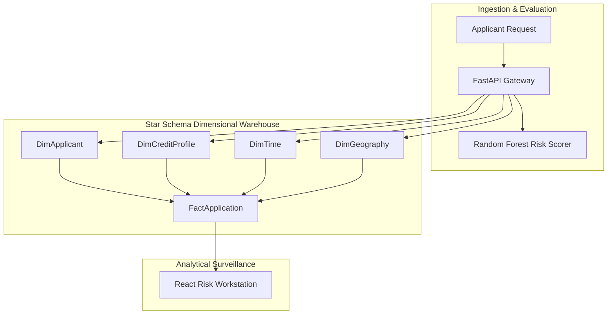

# FinCore AI — Architectural Decision Record & System Design

This document details the engineering choices, trade-offs, and technical designs adopted in **FinCore AI**.

---

## 1. Architectural Foundations

### 1.1 Dual-Engine Design: Dimensional Warehouse + Real-Time Microservice
Credit origination systems often suffer from an architectural mismatch:
- **OLTP Engines** excel at rapid row insertions but struggle when risk officers run portfolio-wide analytics across credit bands, time horizons, and geographies.
- **OLAP Data Warehouses** (e.g. Snowflake, BigQuery) provide excellent reporting but introduce unacceptable ingestion lag when an applicant expects sub-second decisions.

**FinCore Solution**:
We implemented an in-process **Star Schema dimensional structure** within SQLAlchemy. By modeling `DimApplicant`, `DimCreditProfile`, `DimGeography`, and `DimTime` alongside `FactApplication`, the system achieves:
1. Sub-30ms atomic writes across all dimensions and facts.
2. Immediate analytical slicing without needing an asynchronous ETL batch cycle.

---

## 2. Key Technology Choices

### 2.1 Why Random Forest Over Deep Learning for Credit Underwriting?
- **Explainability & Compliance**: Consumer financial protection regulations (e.g., US Equal Credit Opportunity Act) mandate that lenders provide concrete adverse action reasons whenever credit is denied. Deep neural networks and LLMs act as uninterpretable black boxes in tabular credit scoring. Random Forests allow feature importance extraction, tree traversal auditing, and predictable decision bounds.
- **Latency & Footprint**: Random Forest inference takes $\sim 6\text{ms}$ on CPU, avoiding GPU hardware overhead and external cloud API dependencies.

### 2.2 FastAPI vs Flask
- While FinCore includes a legacy Flask interface (`app.py`), the primary high-throughput engine is built on **FastAPI** (`main.py`).
- **Pydantic v2 validation** automatically enforces strict typing on inbound applicant payloads (`ApplicantCreate`), returning standardized 422 errors for malformed credit data.
- Native asynchronous handlers allow non-blocking concurrency for high request volumes.

### 2.3 React 19 + Vite Frontend
- The UI is designed as an executive-grade financial terminal with dark-mode glassmorphism, instant simulation sliders, real-time KPI metric tiles, and transactional review queues.
- Vite provides sub-second HMR and an ultra-lean bundle footprint.

---

## 3. Risk Mitigation & Future Roadmap

1. **Database Migration to Distributed PostgreSQL**:
   - For scale beyond 100,000 active loans, the SQLAlchemy engine seamlessly ports from SQLite to PostgreSQL with `pg_partman` for time-partitioned fact tables.
2. **Explainability Hooks (SHAP Values)**:
   - Future phases will integrate TreeSHAP to automatically generate per-applicant adverse action letters with the top 3 negative contributing factors.
3. **Multi-Regional Ingestion**:
   - Expansion of `DimGeography` to support multi-currency, regional regulatory compliance flags, and cross-border lending syndications.
