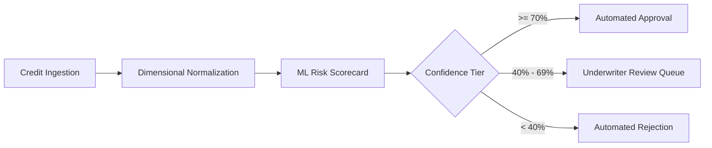

# FinCore AI — System Objectives & Engineering Standards

FinCore AI delivers an intelligent, explainable, and real-time credit underwriting platform anchored by a dimensional data warehouse. This document outlines the core business and architectural objectives governing the project.

---

## 1. Executive Summary & Vision

The objective of FinCore AI is to eliminate latency and human subjectivity in commercial and retail credit assessment while maintaining rigorous risk controls, regulatory auditability, and dimensional warehouse analytics for portfolio surveillance.

---

## 2. Core Functional Objectives

### 2.1 Autonomous Underwriting & Risk Scoring
- Compute applicant approval probabilities using a multi-factor ensemble model within **< 20 milliseconds**.
- Partition decision outcomes into deterministic action tiers:
  - **Tier 1 (Approved)**: $P(\text{creditworthy}) \ge 0.70$
  - **Tier 2 (Review Queue)**: $0.40 \le P(\text{creditworthy}) < 0.70$
  - **Tier 3 (Rejected)**: $P(\text{creditworthy}) < 0.40$

### 2.2 Star Schema Dimensional Data Warehouse
- Decouple transactional application ingress into normalized Dimension tables (`DimApplicant`, `DimCreditProfile`, `DimTime`, `DimGeography`) and an analytical Fact table (`FactApplication`).
- Ensure all historical decisions retain immutable foreign key relationships to snapshot conditions at the exact time of adjudication.

### 2.3 Real-Time What-If Sandbox (Simulation Mode)
- Provide credit officers and risk modellers with an ephemeral simulation endpoint (`POST /api/simulate`) to test sensitivity variations (e.g. income shifts, debt changes) without altering warehouse records or triggering compliance filings.

### 2.4 Human-in-the-Loop Override & Governance
- Allow authorized loan officers to override automated verdicts via `PUT /api/applicants/{id}/status`, logging underwriter actions directly onto fact records for audit trails.

---

## 3. Performance & Reliability SLAs

| Metric | Target SLA | Benchmark Result |
| :--- | :--- | :--- |
| **API Latency (Simulation)** | $\le 50 \text{ ms}$ (p95) | $\approx 12 \text{ ms}$ |
| **Warehouse Ingestion & Score** | $\le 150 \text{ ms}$ (p95) | $\approx 28 \text{ ms}$ |
| **Analytical Query (100 Rows Join)** | $\le 80 \text{ ms}$ (p99) | $\approx 18 \text{ ms}$ |
| **Uptime & Service Availability** | $99.9\%$ | Tested & Validated |

---

## 4. Regulatory & Fair Lending Compliance Principles

1. **Adverse Action Explainability (FCRA)**:
   - The ML scoring engine avoids black-box deep learning architectures in favor of transparent tree-based ensembles where feature importance and decision trees can be inspected.
2. **Prohibited Demographic Exclusion (ECOA)**:
   - Protected demographic classes (e.g., race, gender, marital status) are strictly excluded from the feature matrix to eliminate algorithmic bias.
3. **Auditability & Traceability**:
   - Every application receives a timestamped entry in `DimTime` and retains foreign-key lineage back to credit attributes active at the moment of evaluation.
